

  

<h1 align="center">Pocket Class</h1>

<b>Your class files, in your pocket.</b> 
An iPhone app where teachers share presentations and exercises with their class.

  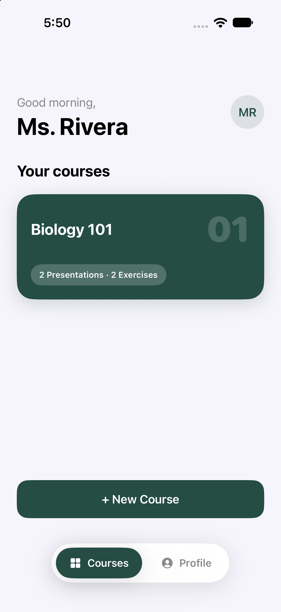
  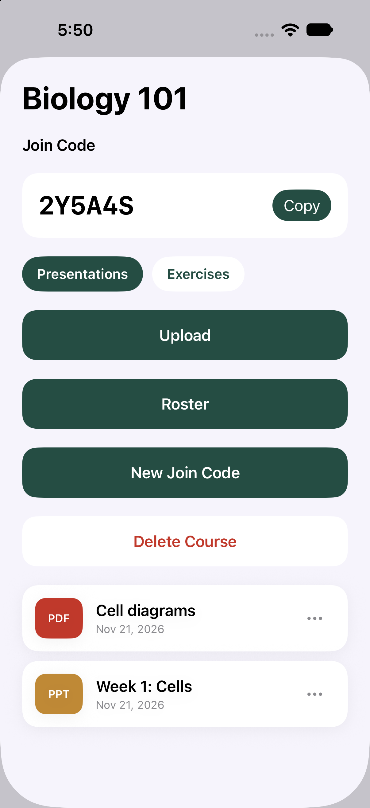
  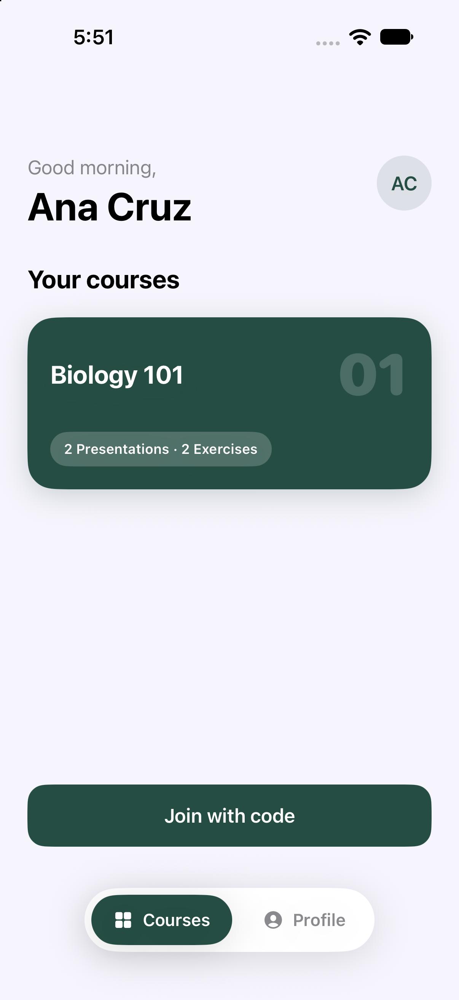
  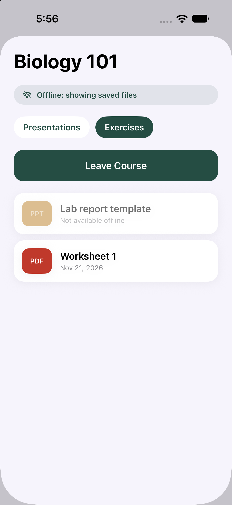

## Overview

**Pocket Class** is a school project: a small learning management system (LMS) for the iPhone. Teachers create a Course, upload their slides and practice files, and share a Join Code. Students type the code and every Presentation and Exercise for that Course is on their phone, even without internet once opened.

It has two kinds of users:

- **Teachers** create Courses and upload files.
- **Students** join Courses and open the files.

## What it does

- **Courses with Join Codes:** a Teacher creates a Course and gets a short, easy-to-read code. A new code can be made at any time, and the old one stops working.
- **Uploads:** Teachers upload Presentations (`.pptx`, `.ppt`, `.key`, `.pdf`) and Exercises (`.pdf`, `.docx`, `.pptx`), up to 50 MB each, and can rename or delete them.
- **Two lists per Course:** Presentations and Exercises, newest first, each with a coloured file-type badge.
- **Preview in the app:** Students and Teachers open files with the built-in iOS preview, and can share them or open them in Keynote, PowerPoint or Files.
- **Offline copies:** files a Student opened open again without internet. Saved copies are cleared when the Student leaves or is removed, or the file or Course is deleted.
- **Roster:** the Teacher sees who joined and can remove a Student; a Student can leave a Course.
- **Accounts:** sign up with email and password as a Teacher or Student (the role never changes), and reset a forgotten password by email.

## Why use Pocket Class

- **One place for class files.** No more slides lost in group chats or email threads.
- **Private by default.** Only the Course's Teacher and the Students on its Roster can see its files. The server enforces this, not just the app.
- **Works offline.** Files you opened stay readable on the bus or without data.
- **Simple to join.** Students need a code, not an invite to their email.
- **Free to run.** It fits on Supabase's free plan.

## How it works

1. The **Teacher** signs up, creates a Course and shares its Join Code.
2. The **Student** signs up and enters the code; the server checks it and adds them to the Course's Roster.
3. The **Teacher** uploads Presentations and Exercises; files go to private storage on **Supabase**.
4. The **Student** opens a file; the app downloads it, previews it, and keeps a copy for offline use.
5. **Supabase's access rules** allow every request only for the Course's Teacher or a Student on its Roster.

### Backend flow

  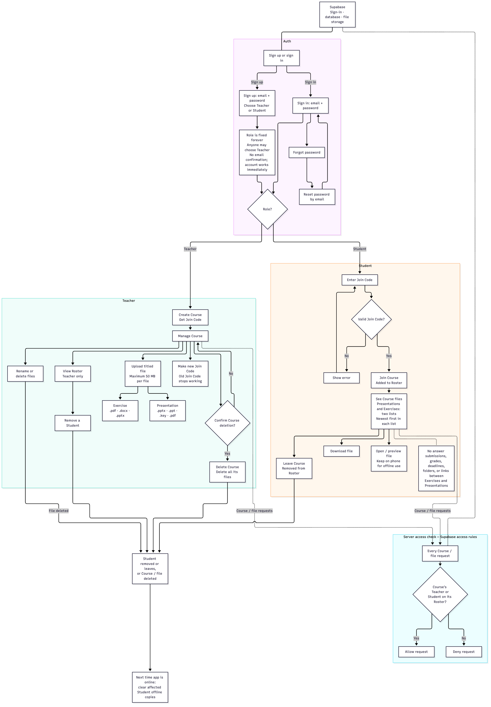

## Screens

| Sign in | Teacher | Student |
| --- | --- | --- |
| 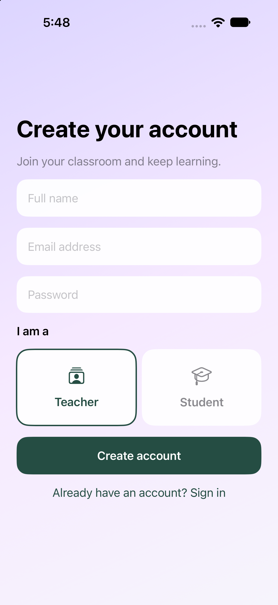 | 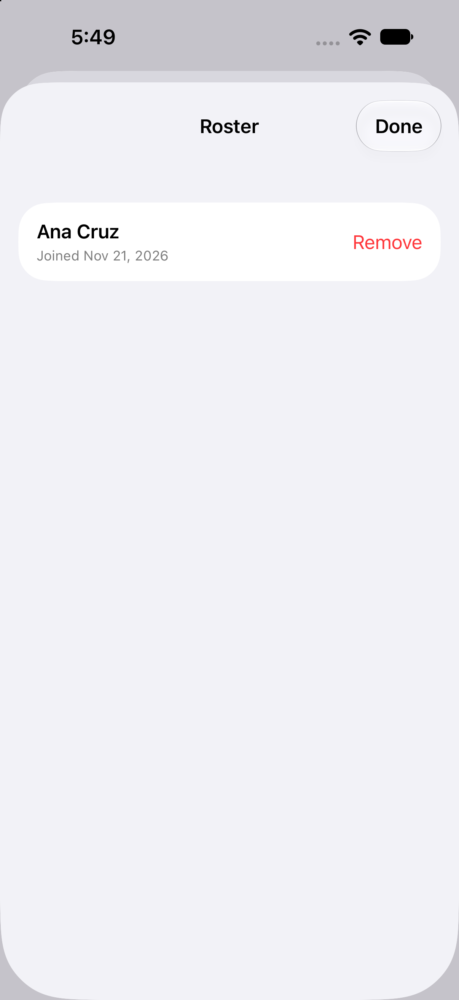 | 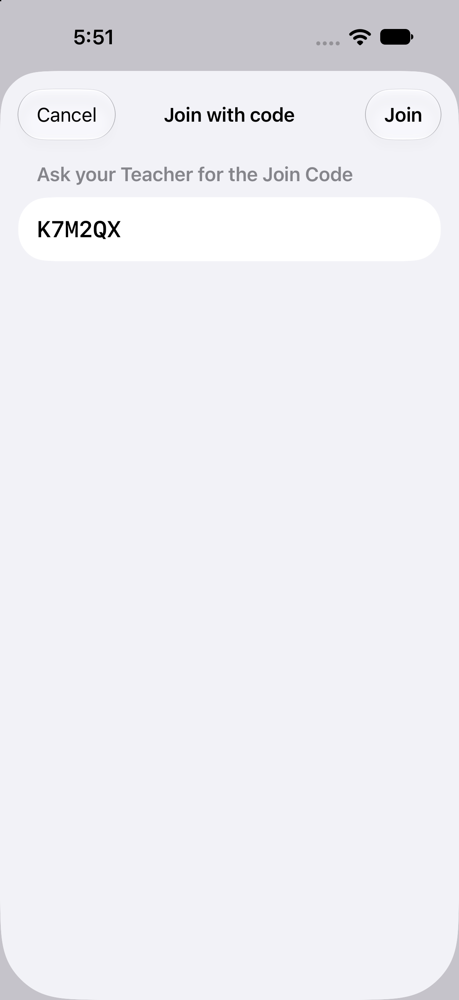 |
| 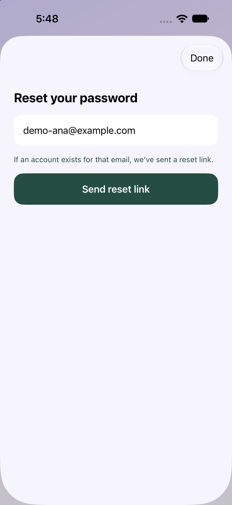 | 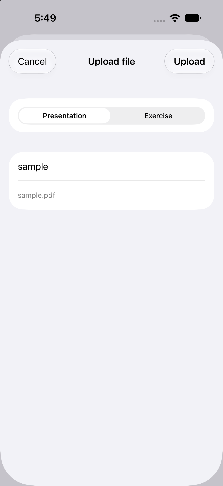 | 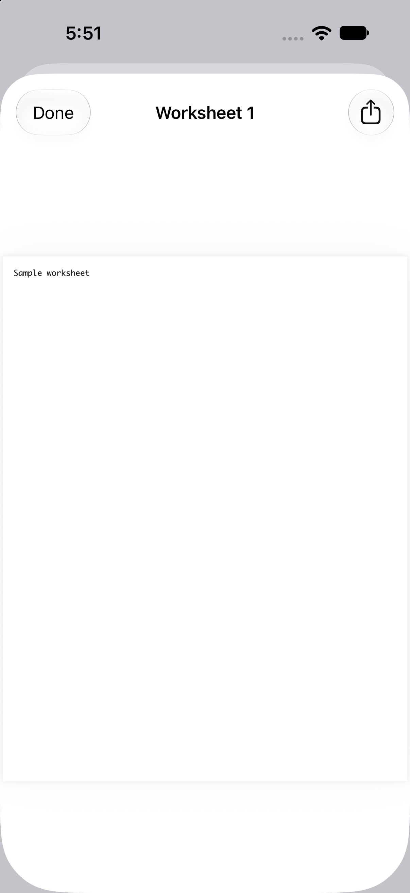 |

All 18 screens are in [`docs/screenshots/final/`](docs/screenshots/final/).

## Tech stack

| Part | Built with |
| --- | --- |
| iPhone app | Swift, SwiftUI, iOS 18+, Quick Look; project generated with [xcodegen](https://github.com/yonaskolb/XcodeGen) |
| Backend | [Supabase](https://supabase.com): Auth, Postgres with row-level security, Storage (private bucket), SQL functions |
| Client library | [supabase-swift](https://github.com/supabase/supabase-swift) |
| Testing | Swift Testing: unit tests on an in-memory backend, integration tests against the real Supabase project |
| Design | Style B: colour-blocked course cards, deep-green accents, floating pill tab bar ([UI direction](docs/design/ui-direction.md)) |

## Getting started

You need a Mac with **Xcode 27** and **xcodegen** (`brew install xcodegen`).

1. Clone the repo and generate the Supabase config as [DEVELOPMENT.md](docs/DEVELOPMENT.md#tests) shows.
2. Run `xcodegen generate`, then open `PocketClass.xcodeproj`.
3. Choose the **PocketClass** scheme and an iPhone simulator, then press **Run**.
4. Optional: run `scripts/seed-demo.sh` to create a demo Teacher, a demo Student and a "Biology 101" Course with files.

### For teachers

1. Sign up and choose **Teacher**.
2. Tap **+ New Course**, give it a name, and share its **Join Code**.
3. Open the Course, tap **Upload**, pick a file, choose Presentation or Exercise and give it a title.
4. Use **Roster** to see who joined, and **New Join Code** if the code leaked.

### For students

1. Sign up and choose **Student**.
2. Tap **Join with code** and enter the code from your teacher.
3. Open the Course and tap a file to preview it, or share it to another app.

## For developers

Tests, demo data, test accounts and clean-up scripts are in [docs/DEVELOPMENT.md](docs/DEVELOPMENT.md). Domain terms are in [GLOSSARY.md](GLOSSARY.md) and decisions in [docs/adr/](docs/adr/).

## Known limitations

- iPhone only, light mode only. No iPad or dark mode.
- Students can't submit answers; there are no grades, deadlines or quizzes.
- Anyone can sign up as a Teacher; a Teacher sees only their own Courses.
- Staying signed in after a relaunch needs a signed build (run from Xcode).
- Uploads show a spinner, not a progress bar.
- Supabase's free plan limits files to 50 MB each and 1 GB in total, and pauses the project after a week without use.
